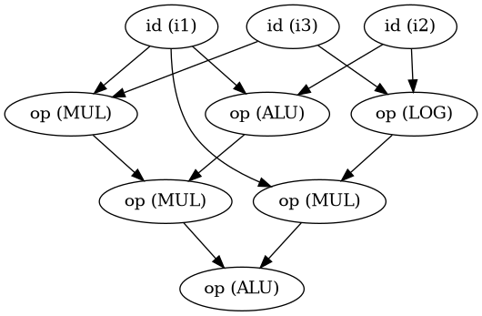
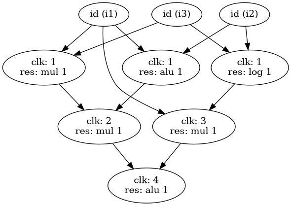

# Computer-Aided Digital System Design

Verilog and Python projects completed for the **Computer Aided Digital System** course at the **University of Tehran**.

The five assignments cover RTL datapath/controller design, bit-serial computation, hardware verification, logic synthesis, technology mapping, and a small high-level synthesis workflow that turns arithmetic expressions into scheduled Verilog designs.

## Projects

| Assignment | Focus | Selected files |
| --- | --- | --- |
| [CA1](CA1/) | A custom hash generator with separate control and datapath logic, a round-index generator, ROM constants, and rotation operations | [`top.v`](CA1/top.v), [`datapath.v`](CA1/datapath.v), [`controller.v`](CA1/controller.v), [`TB.v`](CA1/TB.v), [pseudocode](CA1/pseudocode.txt) |
| [CA2](CA2/) | A Stripes-style processing element for bit-serial dot-product computation, including signed operands and accumulation | [`PE_top.v`](CA2/PE_top.v), [`DataPath.v`](CA2/DataPath.v), [`Controller.v`](CA2/Controller.v), [`final_TB.v`](CA2/final_TB.v), [report](CA2/report.pdf) |
| [CA3](CA3/) | Parameterized hash hardware, component-level testbenches, and supporting verification programs and logs | [`Top.v`](CA3/Top.v), [`tb_all_modules.v`](CA3/tb_all_modules.v), [`verifyTestBench.v`](CA3/verifyTestBench.v), [report](CA3/report.pdf) |
| [CA4](CA4/) | Yosys synthesis to two-input LUTs and Python post-processing to map synthesized logic to custom cells | [`lut2synthesis.ys`](CA4/lut2synthesis.ys), [`lut2mapper.py`](CA4/lut2mapper.py), [`modules.v`](CA4/modules.v), [`TB.v`](CA4/TB.v) |
| [CA5](CA5/) | Expression parsing, data-flow graph construction, constrained scheduling, and Verilog generation | [`main.py`](CA5/main.py), [`scheduler.py`](CA5/src/scheduler.py), [`verilog_generator.py`](CA5/src/verilog_generator.py), [sample projects](CA5/samples/) |

## Highlight: expression-to-Verilog workflow

CA5 implements a small high-level synthesis pipeline:

1. Read an expression and resource configuration from `input.json`.
2. Parse the expression and construct a data-flow graph.
3. Schedule operations using resource-constrained or latency-constrained scheduling.
4. Export the schedule and render graph visualizations.
5. Generate a Verilog datapath, controller, top module, and testbench.

The scheduler groups operations into **ALU**, **MUL**, and **LOG** resource classes. The repository includes sample expressions, schedule outputs, generated code, and graph images.

### Example graphs

The following images are included with sample 1:

| Data-flow graph | Scheduled graph |
| --- | --- |
|  |  |

### Run CA5

Requirements:

- **Python 3.10 or newer**, for the type syntax used in the source.
- The Python `graphviz` package.
- The Graphviz application, with the `dot` executable available on your system path.

Clone the repository and install the Python dependency:

```bash
git clone https://github.com/mhieir/ComputerAiededDesign.git
cd ComputerAiededDesign/CA5
python3 -m pip install graphviz
```

Install Graphviz separately using your operating system's package manager. Confirm that it is available with `dot -V`.

Run a supplied example:

```bash
python3 main.py samples/sample1
```

The argument is a **directory containing `input.json`**, rather than the JSON filename itself. A sample input is:

```json
{
  "Expression": "(i1 + i2) * (i1 / i3) + (i2 & i3) * i1",
  "Algorithm": "MinResourceLatencyConstrained",
  "Config": {
    "MaxTime": 10,
    "Resources": {
      "ALU": 1,
      "MUL": 1,
      "LOG": 1
    }
  }
}
```

The implementation uses these algorithm identifiers, including the spelling shown below:

| Identifier | Scheduling mode |
| --- | --- |
| `MinResourceLatencyConstrained` | Latency-constrained resource scheduling |
| `MinLatencyResourceContrained` | Resource-constrained latency scheduling |

Outputs are written into the selected sample directory:

- `output.json`: scheduled clock step, resource type, and resource number for each operation.
- `pics/DFG.png`: expression graph.
- `pics/ScheduledDFG.png`: scheduled graph.
- `codes/my_datapath.v`, `codes/my_controller.v`, and `codes/my_top.v`: generated RTL.
- `codes/tb.v`: generated testbench.

Existing outputs with these names are replaced. To keep the supplied examples unchanged, copy a sample directory before running the generator. This is an educational synthesis tool; inspect and simulate generated RTL for the expression you use.

## RTL simulation

CA1–CA4 contain Verilog source files and testbenches. ModelSim/Questa project files and simulation artifacts are included for some assignments.

For each assignment:

1. Set the simulator's working directory to that assignment's folder, so relative memory-file paths resolve correctly.
2. Create a fresh simulation library and compile the relevant design modules and testbench.
3. Select the testbench as the simulation top and run the simulation.
4. Inspect the printed results and waveforms.

Compile assignments separately: module names are reused across folders. CA2 also contains a `src/` copy of its design; choose one source set to avoid duplicate module definitions. CA3 contains multiple testbench collections, so select the specific testbench and dependencies you want to run.

The hash implementations follow the course's custom algorithms and parameters. They should not be described as standard MD5 implementations.

## Logic synthesis and mapping: CA4

CA4 requires **Yosys** and Python. From the repository root:

```bash
cd CA4
yosys -s lut2synthesis.ys
python3 lut2mapper.py synth_output.v --cell c2 --count-cells
```

The Yosys script selects `Top`, synthesizes the design with `synth -lut 2`, and writes `synth_output.v`. The mapper processes the synthesized LUTs and supported flip-flop patterns, writes `mapped_synth_output.v` and `modules.v`, and prints mapped-cell counts. The mapper supports `c1` and `c2` cell selections.

Generated netlists are included for inspection; their presence alone does not establish equivalence or timing closure.

## Documents and supporting files

Each assignment includes its own source, input data, and supporting material. Useful documents include:

- [CA1 assignment](CA1/CAD-CA1.pdf) and [datapath diagram](CA1/datapath.pdf).
- [CA2 assignment](CA2/CAD-CA2.pdf) and [report](CA2/report.pdf).
- [CA3 report](CA3/report.pdf).
- [CA4 assignment](CA4/CAD-CA4.pdf) and [datapath diagram](CA4/datapath.pdf).
- [CA5 assignment](CA5/CAD-F04-CA5.pdf).

Some CA3 C++ helpers use Windows-specific APIs such as `windows.h`; those programs require a compatible Windows build environment. Prebuilt executables and simulator work directories are historical artifacts, so rebuild sources for your own tools and platform.

## Author

[Mahdis Mirzaei](https://github.com/mhieir) · Computer Engineering, University of Tehran

Some assignments include team submissions; refer to the accompanying reports for contributor details.
